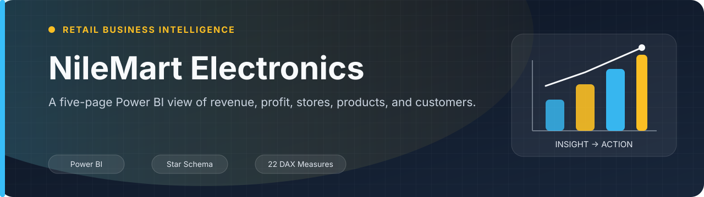
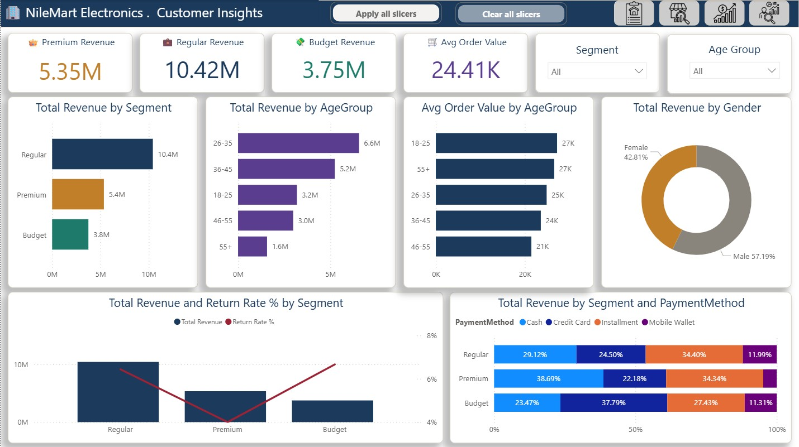
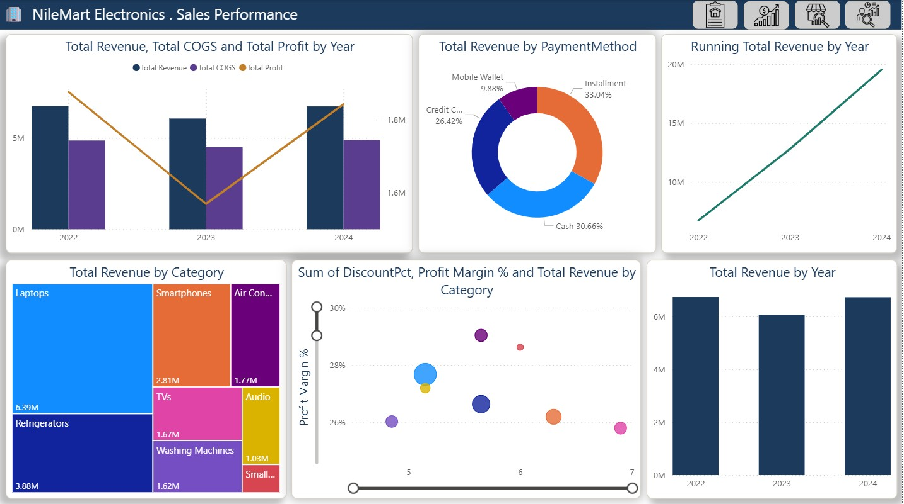
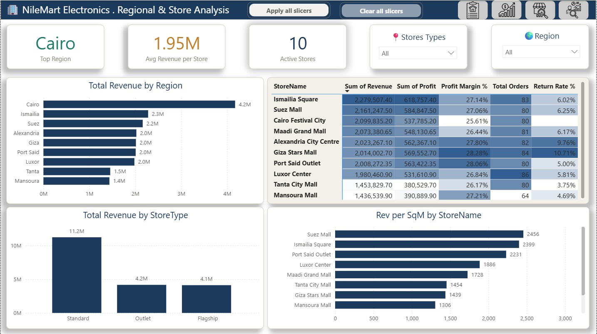
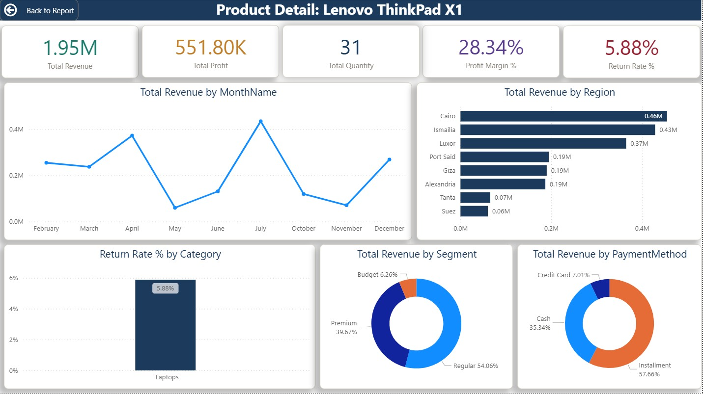

<div align="center">



# NileMart Electronics

**Retail business intelligence · Power BI · 2022–2024**

   

</div>

---

## Dashboard walkthrough

<table>
<tr>
<td width="50%"><br><sub><b>01 · Executive overview</b> — headline KPIs, revenue trends, category mix</sub></td>
<td width="50%"><br><sub><b>02 · Customer insights</b> — segments, demographics, payment mix</sub></td>
</tr>
<tr>
<td width="50%"><br><sub><b>03 · Sales performance</b> — profit, cost, discounts, time trends</sub></td>
<td width="50%"><br><sub><b>04 · Regional and store analysis</b> — region and store comparisons</sub></td>
</tr>
<tr>
<td width="50%"><br><sub><b>05 · Product detail</b> — drill-through product analysis</sub></td>
<td width="50%"></td>
</tr>
</table>

---

## Headline numbers (full period)

| Metric | Value |
|---|---|
| Total revenue | 19.53M |
| Total profit | 5.29M |
| Profit margin | 27.08% |
| Orders | 800 |
| Stores / products / customers | 10 / 40 / 200 |
| Return rate | 5.88% |

## What the data shows

- Revenue by year: 6.74M (2022), 6.06M (2023, down 10.0%), 6.73M (2024, up 11.0%).
- Cairo is the largest region with 21.4% of revenue. No other region is above 11.7%.
- The top 5 products account for 35.2% of revenue. The largest is the Lenovo ThinkPad X1 at 1.95M.
- Laptops are the largest category at 32.7% of revenue, followed by Refrigerators at 19.8%.

## Report pages

| # | Page | Purpose |
|---|---|---|
| 1 | Overview | KPI cards, monthly revenue by year, revenue by category, year-over-year growth, top products |
| 2 | Customer Insights | Revenue by segment, age group, gender and payment method, return rate by segment |
| 3 | Sales Performance | Revenue, COGS and profit by year, running total, category treemap, discount vs margin |
| 4 | Regional and Store Analysis | Revenue by region and store type, store table with margin and return rate, revenue per square meter |
| 5 | Product Detail | Drill-through page for a single product |

More screenshots are in [`screenshots/`](screenshots/). A screen recording is in [`demo/`](demo/dashboard-walkthrough.mp4).

## Data model

Star schema with 5 tables. `Sales` is the fact table. `Customers`, `Products`, `Stores` and `DateTable` are the dimensions, each joined to `Sales` on its key (`OrderDate` joins to `DateTable[Date]`).

## DAX measures

The model has 22 measures, including:

- Time intelligence: `YoY Growth %`, `PY Revenue`, `MTD Revenue`, `QTD Revenue`, `YTD Revenue`, `Running Total Revenue`
- Retail KPIs: `Profit Margin %`, `Avg Order Value`, `Return Rate %`, `Rev per SqM`, `Avg Revenue per Store`
- Ranking and share: `Category Rank`, `Revenue % of Total`, `Top Region`
- Dynamic page title for the drill-through page

## Files

```
dashboard/   Power BI report (.pbix)
data/        Source CSV files (Sales, Customers, Products, Stores, DateTable)
screenshots/ One image per report page
demo/        Screen recording of the report
```

To open the report, use Power BI Desktop. If the data source path is broken on your machine, update it in Transform data > Data source settings and point it to the `data/` folder.

## Data note

The dataset is synthetic. For example, customers are named `Customer_1` to `Customer_200`. It contains no real customer data.

## Author

Eslam TagElsir. [LinkedIn](https://www.linkedin.com/in/eslam-tagelsir) · [GitHub](https://github.com/EslamTagElsir)
